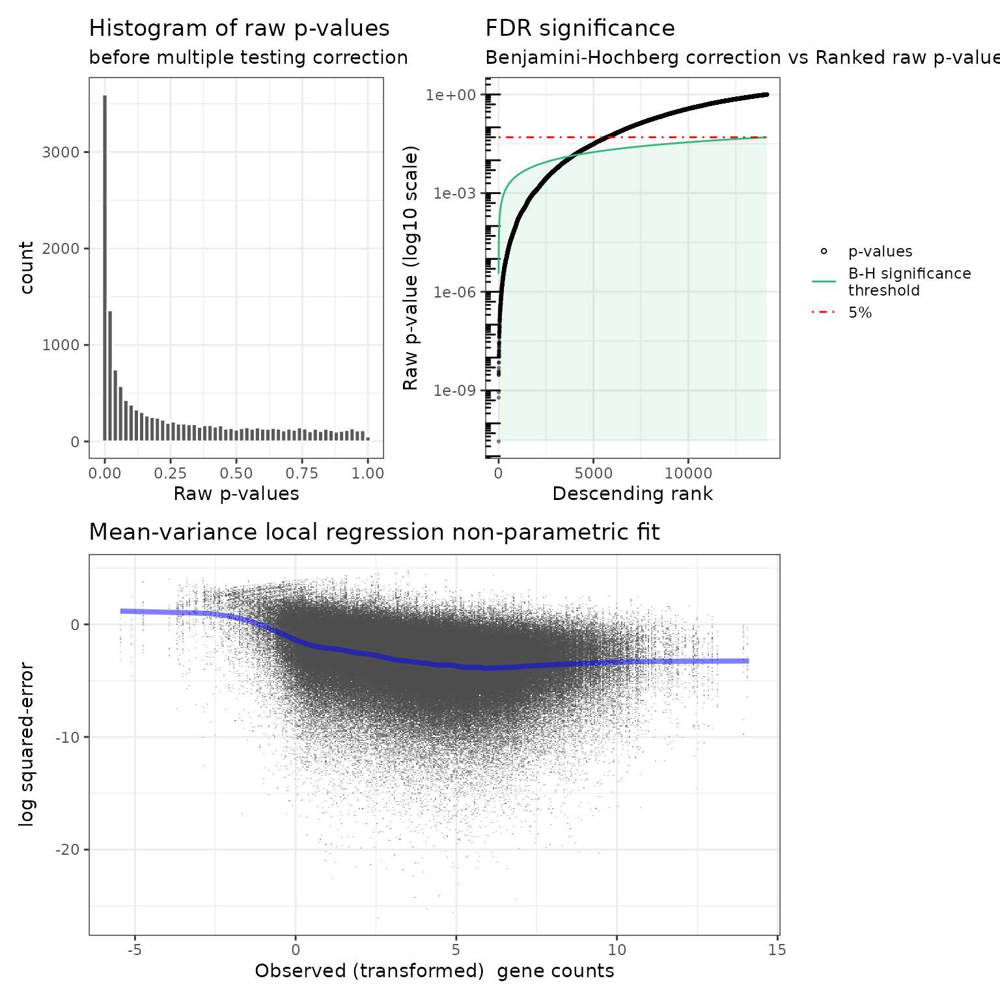
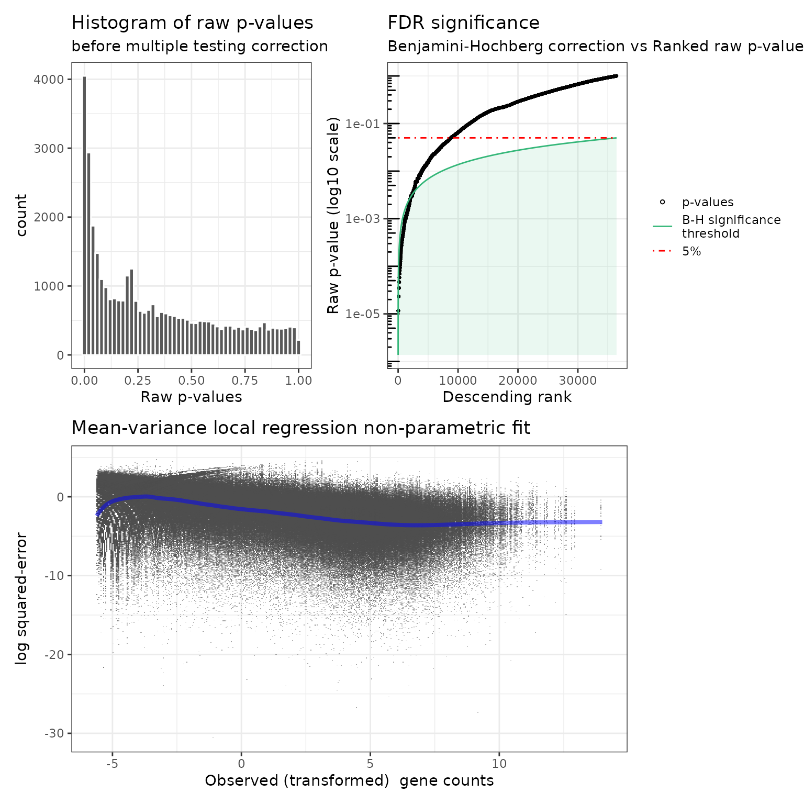
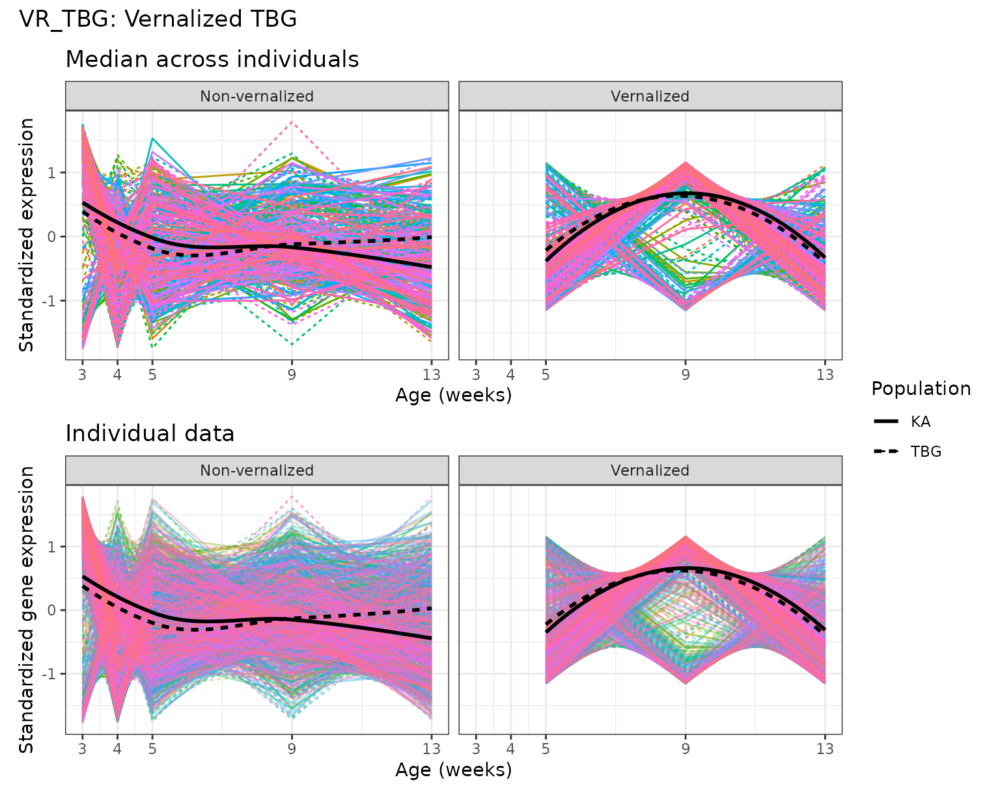

# User guide to the \`dearseq\` R package


## Overview of `dearseq`

`dearseq` is an `R` package that performs **D**ifferential
**E**xpression **A**nalysis of **R**NA-**seq** data, while guaranteeing
a *sound control of false positives* (Gauthier *et al.*, 2019). It
relies on variance component score test accounting for data
heteroscedasticity through precision weights, not unlike `voom` (Law *et
al.*, 2014). It can perform either

- **gene-wise** differential analysis, or
- **gene set analysis**

In addition, `dearseq` can deal with various and complex experimental
designs such as:

- **multiple biological conditions**,
- **repeated or longitudinal measurements**

More details are provided Gauthier M, Agniel D, Thiébaut R & Hejblum BP
(2020). dearseq: a variance component score test for RNA-Seq
differential analysis that effectively controls the false discovery
rate, *NAR Genomics and Bioinformatics*, 2(4):lqaa093.  
[DOI: 10.1093/nargab/lqaa093](https://doi.org/10.1093/nargab/lqaa093)

## Using `dearseq` for a gene-wise analysis

### Getting started using `dear_seq()`

Two inputs are required to run
[`dear_seq()`](https://borishejblum.github.io/dearseq/reference/dear_seq.md):

- The gene expression matrix
- The data.frame containing the variables of interested to be tested
  (e.g.  the group factor)

Both can be supplied in the formed of a `SummarizedExperiment` object
for instance. A third optional input is the covariates that will be
adjusted on (such as age for instance).

### An example analysis

Tuberculosis (TB) is a disease caused by a bacterium called
Mycobacterium tuberculosis. Bacteria typically infect the lungs, but
they can also affect other parts of the body. Tuberculosis can remain in
a quiescent state in the body. It is called latent tuberculosis
infection (LTBI). It is an infection without clinical signs,
bacteriological and radiological disease.

*Berry et al.* first identified a whole blood 393 transcript signature
for active TB using microarray analysis. Then, *Singhania et al.* found
a 373-genes signature of active tuberculosis using RNA-Seq, confirming
microarray results, that discriminates active tuberculosis from latently
infected and healthy individuals.

We sought to investigate how many of the 373 genes *Singhania et al.*
found using edgeR might actually be false positives. As a quick example,
we propose a partial re-analysis (see *Gauthier et al.* for the complete
analysis) of the *Singhania et al.* dataset: we proceed to the
Differential Expression Analysis (DEA) of the Active TB group against
the Control one, omitting LTBI/Control and ActiveTB/LTBI comparisons. We
focused on the Berry London dataset.

It results in 54 patients of whom 21 are active TB patients, 21 are
latent TB patients and 12 are healthy control particiants.

For more details, check the article from *Berry et al., 2010*
[here](https://pmc.ncbi.nlm.nih.gov/articles/PMC3492754/).

#### Data preparation

Data from *Singhania et al.* inverstigating active TB are publicly
available on [GEO website](https://www.ncbi.nlm.nih.gov/geo/) with GEO
access number ‘GSE107995’. Thanks to the `GEOquery` package to get the
data files from GEO website (see appendix for more details on
`GEOquery`)

##### Design data matrix

``` r

library(GEOquery)
GSE107991_metadata <- GEOquery::getGEO("GSE107991", GSEMatrix = FALSE)

get_info <- function(i) {
    name <- GEOquery::Meta(GSMList(GSE107991_metadata)[[i]])$source_name_ch1
    name <- gsub("Active_TB", "ActiveTB", name)
    name <- gsub("Test_set", "TestSet", name)
    c(unlist(strsplit(name, split = "_")), GEOquery::Meta(GSMList(GSE107991_metadata)[[i]])$title)
}

infos <- vapply(X = 1:length(GSMList(GSE107991_metadata)), FUN = get_info, FUN.VALUE = c("a",
    "b", "c", "d", "e"))
infos_df <- cbind.data.frame(SampleID = names(GSMList(GSE107991_metadata)), t(infos),
    stringsAsFactors = TRUE)
rownames(infos_df) <- names(GEOquery::GSMList(GSE107991_metadata))
colnames(infos_df)[-1] <- c("Cohort", "Location", "Set", "Status", "SampleTitle")
```

##### Gene expression matrix

This matrix contains the gene expression (in cells) for each gene (in
rows) of each sample (in columns) gathered from RNA-seq measurements.
The gene expression could already be normalized, or not (e.g. raw counts
or pseudo-counts straight from the alignment). In the latter case, the
gene expression is normalized then into log(counts) per million
(i.e. *log-cpm*).

The gene expression matrix (called `London`) is including in the package
`dearseq`. It was extracted from one of the GEO supplementary files
(namely the “GSE107991_edgeR_normalized_Berry_London.xlsx” file).

**NB:** These expression data have already been already normalized using
`edgeR`

``` r

library(readxl)
# library(rio) url_london <- GEOquery::getGEOSuppFiles('GSE107991',
# filter_regex='edgeR_normalized_Berry_London', fetch_files = FALSE)$url[1]
# London <- rio::import(url_london)

GEOquery::getGEOSuppFiles("GSE107991", filter_regex = "edgeR_normalized_Berry_London")
London <- readxl::read_excel("GSE107991/GSE107991_edgeR_normalized_Berry_London.xlsx")
genes <- London$Genes
London <- as.matrix(London[, -c(1:3)])
rownames(London) <- genes
```

We have `nrow(London)` genes in rows and `ncol(London)` samples in
columns \* rownames are Ensembl IDs `ENSGxxxxxxxxxxx` for each gene
(saved in `genes`) \* colnames are the name of each sample
`Berry_London_Samplex` \* each data-cell contains the normalized gene
expression

The vector `genes` contains all the gene identifiers.

#### Identifying differentially expressed genes (DEG) from `dearseq` variance component score test

The main arguments to the
[`dear_seq()`](https://borishejblum.github.io/dearseq/reference/dear_seq.md)
function are:

- `exprmat`: a numeric matrix containing the raw RNA-seq counts or
  preprocessed expressions
- `covariates`: a numeric matrix containing the model covariates that
  needs to be adjusted. Usually, its first column is the intercept (full
  of 1s).
- `variables2test`: a numeric design matrix containing the variables of
  interest (with whom the expression association is tested)
- `which_test`: a character string indicating which method to use to
  approximate the variance component score test, either “permutation” or
  “asymptotic”.
- `preprocessed`: a logical flag indicating whether the expression data
  have already been preprocessed (e.g. log2 transformed). Default is
  FALSE, in which case y is assumed to contain raw counts and is
  normalized into log(counts) per million.

We use the permutation test because of the relatively small sample size
($`n=33`$).

``` r

library(dearseq)
library(SummarizedExperiment)
col_data <- data.frame(Status = infos_df$Status)
col_data$Status <- stats::relevel(col_data$Status, ref = "Control")
rownames(col_data) <- infos_df$SampleTitle
se <- SummarizedExperiment(assays = London, colData = col_data)

res_dearseq <- dearseq::dear_seq(object = se[, se$Status != "LTBI"], variables2test = "Status",
    which_test = "asymptotic", preprocessed = TRUE)
summary(res_dearseq)
#> dearseq identifies 3945 significant genes out of 14150 
#>  - test: asymptotic 
#>  - FDR significance level: 0.05
plot(res_dearseq)
#> Warning: `aes_string()` was deprecated in ggplot2 3.0.0.
#> ℹ Please use tidy evaluation idioms with `aes()`.
#> ℹ See also `vignette("ggplot2-in-packages")` for more information.
#> ℹ The deprecated feature was likely used in the dearseq package.
#>   Please report the issue at <https://github.com/borishejblum/dearseq/issues>.
#> This warning is displayed once per session.
#> Call `lifecycle::last_lifecycle_warnings()` to see where this warning was
#> generated.
#> Warning: Using `size` aesthetic for lines was deprecated in ggplot2 3.4.0.
#> ℹ Please use `linewidth` instead.
#> ℹ The deprecated feature was likely used in the dearseq package.
#>   Please report the issue at <https://github.com/borishejblum/dearseq/issues>.
#> This warning is displayed once per session.
#> Call `lifecycle::last_lifecycle_warnings()` to see where this warning was
#> generated.
```



`res_dearseq` is a list containing:

- the input values for `which_test`, `nperm` and `preprocessed`
- the gene-wise p-values (raw and adjusted - default is correction for
  multiple testing with the Benjamini-Hochberg procedure)

**NB:** We excluded the LTBI patients to focus on the comparison between
Active TB versus Control patients.

#### Using gene expression matrix of raw counts

If the gene expression could not already be normalized, the gene
expression is normalized then into log(counts) per million
(i.e. *log-cpm*). We set `preprocessed` equal to FALSE, the default
parameter to normalize the raw counts.

The matrix of raw counts (Raw_counts_Berry_London) contains $`58,051`$
genes and $`54`$ samples. As described in Singhania *et al.*, only genes
expressed with counts per million (CPM) $`> 2`$ in at least five samples
were considered. The filtering is carried out with `edgeR`. It results
in a matrix of raw counts containing $`14,150`$ genes and $`54`$ samples
(London_raw). Of note, many filtering and normalization methods may be
considered and the user must be cautious applying them.

``` r

library(readxl)
library(edgeR)
GEOquery::getGEOSuppFiles("GSE107991", filter_regex = "Raw_counts_Berry_London")
London_raw <- readxl::read_excel("GSE107991/GSE107991_Raw_counts_Berry_London.xlsx")
genes_raw <- London_raw$Genes
London_raw <- as.matrix(London_raw[, -c(1:3)])

se_raw <- SummarizedExperiment(assays = London_raw, colData = col_data)

group <- ifelse(se_raw$Status == "ActiveTB", 1, 0)
dgList <- DGEList(counts = London_raw, group = group)
cpm <- cpm(dgList)
countCheck <- cpm > 2
keep <- which(rowSums(countCheck) >= 5)
London_raw <- London_raw[keep, ]

res_dearseq <- dearseq::dear_seq(object = se_raw[, se_raw$Status != "LTBI"], variables2test = "Status",
    which_test = "permutation", preprocessed = FALSE, parallel_comp = interactive())

summary(res_dearseq)
plot(res_dearseq)
```



## Using `dearseq` for gene-set analysis

Here we will use a subsample of the RNA-seq data from Baduel *et al.*
(2016) studying Arabidopsis Arenosa physiology, that is included in the
`dearseq` package.

We investigates 2 gene sets that were derived in a data-driven manner By
Baduel *et al.* (2016).

``` r

library(dearseq)
library(SummarizedExperiment)
library(BiocSet)
data("baduel_5gs")
se2 <- SummarizedExperiment(assay = log2(expr_norm_corr + 1), colData = design)
genes_non0var_ind <- which(matrixStats::rowVars(expr_norm_corr) != 0)

KAvsTBG <- dearseq::dgsa_seq(object = se2[genes_non0var_ind, ], covariates = c("Vernalized",
    "AgeWeeks", "Vernalized_Population", "AgeWeeks_Population"), variables2test = "PopulationKA",
    genesets = baduel_gmt$genesets[c(3, 5)], which_test = "permutation", which_weights = "loclin",
    n_perm = 2000, preprocessed = TRUE, verbose = FALSE, parallel_comp = interactive())
summary(KAvsTBG)
#> dearseq identifies 1 significant gene sets out of 2 
#>  - test: permutation 
#>  - FDR significance level: 0.05
KAvsTBG$pvals
#>                rawPval   adjPval
#> VR_TBG     0.937531234 0.9375312
#> DE_KAvsTBG 0.008495752 0.0169915

Cold <- dearseq::dgsa_seq(object = se2[genes_non0var_ind, ], covariates = c("AgeWeeks",
    "PopulationKA", "AgeWeeks_Population"), variables2test = c("Vernalized", "Vernalized_Population"),
    genesets = baduel_gmt$genesets[c(3, 5)], which_test = "permutation", which_weights = "loclin",
    n_perm = 2000, preprocessed = TRUE, verbose = FALSE, parallel_comp = interactive())
summary(Cold)
#> dearseq identifies 2 significant gene sets out of 2 
#>  - test: permutation 
#>  - FDR significance level: 0.05
Cold$pvals
#>               rawPval    adjPval
#> VR_TBG     0.02398801 0.03698151
#> DE_KAvsTBG 0.03698151 0.03698151
```

We can also visualize the (pseudo-)longitudinal expression within a gene
set:

``` r

#Remove "non-vernalized" samples
colData(se2)[["Indiv"]] <- colData(se2)[["Population"]]:colData(se2)[["Replicate"]]
colData(se2)[["Vern"]] <- ifelse(colData(se2)[["Vernalized"]], "Vernalized", "Non-vernalized")

library(ggplot2)
library(patchwork)
spaghettiPlot1GS(gs_index = 3, gmt = baduel_gmt, expr_mat = assay(se2), 
  design = colData(se2), var_time = AgeWeeks, var_indiv = Indiv, 
  sampleIdColname = "sample", var_group=Vern, var_subgroup=Population, loess_span = 1.5) &
  ggplot2::xlab("Age (weeks)") & #changing the label of the x axis
  guides(color= "none") # removing the color legend for genes because there are too many
```



## Bibliography

Agniel D & Hejblum BP (2017). Variance component score test for
time-course gene set analysis of longitudinal RNA-seq data.
*Biostatistics* 18(4):589-604. [DOI:
10.1093/biostatistics/kxx005](https://doi.org/10.1093/biostatistics/kxx005).

Baduel P, Arnold B, Weisman CM, Hunter B & Bomblies K (2016).
Habitat-Associated Life History and Stress-Tolerance Variation in
Arabidopsis Arenosa. *Plant Physiology*, 171(1):437-51. [DOI:
10.1104/pp.15.01875](https://doi.org/10.1104/pp.15.01875).

Berry MP, Graham CM, McNab FW, Xu Z, Bloch SAA, Oni T, Wilkinson KA,
Banchereau R, Skinner J, Wilkinson RJ, Quinn C, Blankenship D, Dhawan R,
Cush JJ, Mejias A, Ramilo O, Kon OM, Pascual V, Banchereau J, Chaussabel
D & O’Garra A (2010). An interferon-inducible neutrophil-driven blood
transcriptional signature in human tuberculosis. *Nature* 466:973–977.
[DOI: 10.1038/nature09247](https://doi.org/10.1038/nature09247)

Gauthier M, Agniel D, Thiébaut R & Hejblum BP (2020). dearseq: a
variance component score test for RNA-Seq differential analysis that
effectively controls the false discovery rate. *NAR Genomics and
Bioinformatics*, 2(4):lqaa093. [DOI:
10.1093/nargab/lqaa093](https://doi.org/10.1093/nargab/lqaa093)

Singhania A, Verma R, Graham CM, Lee J, Tran T, Richardson M, Lecine P,
Leissner P, Berry MPR, Wilkinson RJ, Kaiser K, Rodrigue M, Woltmann G,
Haldar P, O’Garra A, (2018). A modular transcriptional signature
identifies phenotypic heterogeneity of human tuberculosis infection.
*Nature communications* 9(1):2308. [DOI:
10.1038/s41467-018-04579-w](https://doi.org/10.1038/s41467-018-04579-w)

## Appendix

### `GEOquery` package

In case the data you want to analyze is publicly available through [Gene
Expression Omnibus (GEO)](https://www.ncbi.nlm.nih.gov/geo/), you can
access it with the `GEOquery` package, that can be installed with the
following commands:

``` r

if (!requireNamespace("GEOquery", quietly = TRUE)) {
    if (!requireNamespace("BiocManager", quietly = TRUE)) {
        install.packages("BiocManager")
    }
    BiocManager::install("GEOquery")
}
```

### `readxl`

The `readxl` package allows to easily imports data from Excel format and
can be similarly installed with the following commands:

``` r

if (!requireNamespace("readxl", quietly = TRUE)) {
    install.packages("readxl")
}
```

More details can be found on
[Bioconductor](https://bioconductor.org/packages/release/bioc/html/GEOquery.html)
and in Davis S, Meltzer P, (2007) GEOquery: a bridge between the Gene
Expression Omnibus (GEO) and Bioconductor *Bioinformatics* 14:1846-1847.

### Session Info

    #> R version 4.6.1 (2026-06-24)
    #> Platform: x86_64-pc-linux-gnu
    #> Running under: Ubuntu 24.04.5 LTS
    #> 
    #> Matrix products: default
    #> BLAS:   /usr/lib/x86_64-linux-gnu/openblas-pthread/libblas.so.3 
    #> LAPACK: /usr/lib/x86_64-linux-gnu/openblas-pthread/libopenblasp-r0.3.26.so;  LAPACK version 3.12.0
    #> 
    #> locale:
    #>  [1] LC_CTYPE=C.UTF-8       LC_NUMERIC=C           LC_TIME=C.UTF-8       
    #>  [4] LC_COLLATE=C.UTF-8     LC_MONETARY=C.UTF-8    LC_MESSAGES=C.UTF-8   
    #>  [7] LC_PAPER=C.UTF-8       LC_NAME=C              LC_ADDRESS=C          
    #> [10] LC_TELEPHONE=C         LC_MEASUREMENT=C.UTF-8 LC_IDENTIFICATION=C   
    #> 
    #> time zone: UTC
    #> tzcode source: system (glibc)
    #> 
    #> attached base packages:
    #> [1] stats4    stats     graphics  grDevices utils     datasets  methods  
    #> [8] base     
    #> 
    #> other attached packages:
    #>  [1] patchwork_1.3.2             ggplot2_4.0.3              
    #>  [3] BiocSet_1.25.0              dplyr_1.2.1                
    #>  [5] edgeR_4.10.5                limma_3.68.5               
    #>  [7] SummarizedExperiment_1.42.0 GenomicRanges_1.64.0       
    #>  [9] Seqinfo_1.2.0               IRanges_2.46.0             
    #> [11] S4Vectors_0.50.3            MatrixGenerics_1.24.0      
    #> [13] matrixStats_1.5.0           dearseq_1.21.0             
    #> [15] readxl_1.5.0.1              GEOquery_2.80.0            
    #> [17] Biobase_2.72.0              BiocGenerics_0.58.1        
    #> [19] generics_0.1.4             
    #> 
    #> loaded via a namespace (and not attached):
    #>  [1] DBI_1.3.0            pbapply_1.7-5        httr2_1.3.0         
    #>  [4] formatR_1.14         rlang_1.3.0          magrittr_2.0.5      
    #>  [7] otel_0.2.0           compiler_4.6.1       RSQLite_3.53.3      
    #> [10] mgcv_1.9-4           png_0.1-9            systemfonts_1.3.2   
    #> [13] vctrs_0.7.3          reshape2_1.4.5       stringr_1.6.0       
    #> [16] crayon_1.5.3         pkgconfig_2.0.3      fastmap_1.2.0       
    #> [19] XVector_0.52.0       labeling_0.4.3       rmarkdown_2.32      
    #> [22] tzdb_0.5.0           ragg_1.5.2           bit_4.6.0           
    #> [25] purrr_1.2.2          xfun_0.61            cachem_1.1.0        
    #> [28] jsonlite_2.0.0       blob_1.3.0           DelayedArray_0.38.2 
    #> [31] parallel_4.6.1       R6_2.6.1             bslib_0.12.0        
    #> [34] stringi_1.8.9        RColorBrewer_1.1-3   jquerylib_0.1.4     
    #> [37] scattermore_1.2      cellranger_1.1.0     Rcpp_1.1.2          
    #> [40] knitr_1.52           R.utils_2.13.0       readr_2.2.0         
    #> [43] rentrez_1.2.4        Matrix_1.7-5         splines_4.6.1       
    #> [46] tidyselect_1.2.1     abind_1.4-8          yaml_2.3.12         
    #> [49] curl_8.1.0           lattice_0.22-9       tibble_3.3.1        
    #> [52] plyr_1.8.9           KEGGREST_1.52.2      withr_3.0.3         
    #> [55] S7_0.2.2             evaluate_1.0.5       ontologyIndex_2.12  
    #> [58] desc_1.4.3           survival_3.8-6       CompQuadForm_1.4.4  
    #> [61] survey_4.5           xml2_1.6.0           Biostrings_2.80.2   
    #> [64] RcppEigen_0.3.4.0.2  pillar_1.11.1        KernSmooth_2.23-26  
    #> [67] hms_1.1.4            scales_1.4.0         glue_1.8.1          
    #> [70] tools_4.6.1          BiocIO_1.22.0        data.table_1.18.6.1 
    #> [73] locfit_1.5-9.12      fs_2.1.0             XML_3.99-0.25       
    #> [76] grid_4.6.1           tidyr_1.3.2          mitools_2.7         
    #> [79] AnnotationDbi_1.74.0 nlme_3.1-169         cli_3.6.6           
    #> [82] textshaping_1.0.5    S4Arrays_1.12.1      viridisLite_0.4.3   
    #> [85] gtable_0.3.6         R.methodsS3_1.8.2    sass_0.4.10         
    #> [88] digest_0.6.39        SparseArray_1.12.3   farver_2.1.2        
    #> [91] memoise_2.0.1        htmltools_0.5.9      pkgdown_2.2.1       
    #> [94] R.oo_1.27.1          lifecycle_1.0.5      httr_1.4.9          
    #> [97] statmod_1.5.2        bit64_4.8.6
